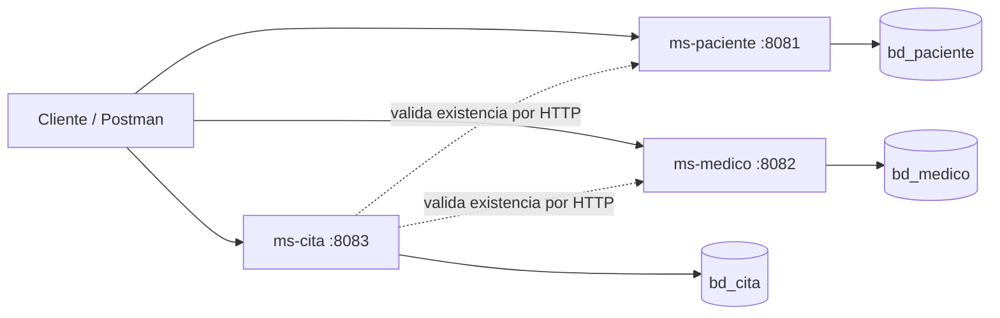

# Laboratorio 01: Sistema de gestión de citas médicas

**Estudiante:** Jeff Amaro | **Sección:** C24A

Tres microservicios con Spring Boot 4, Spring Data JPA y MySQL. Cada uno tiene su propia base de datos y su propio puerto.

## Requisitos

- JDK 17 o superior
- Maven (o el wrapper `mvnw` incluido en cada proyecto)
- MySQL en `localhost:3306` (XAMPP o MySQL Server)
- Postman

## Microservicios, puertos y bases de datos

| Servicio      | Puerto | Base de datos | Responsabilidad                              |
|---------------|--------|---------------|----------------------------------------------|
| `ms-paciente` | 8081   | `bd_paciente` | CRUD de pacientes                            |
| `ms-medico`   | 8082   | `bd_medico`   | CRUD de médicos y especialidad               |
| `ms-cita`     | 8083   | `bd_cita`     | Citas; guarda solo `pacienteId` y `medicoId` |

## Diagrama


---


Versión en texto (Mermaid):



`ms-cita` no accede a las bases de datos de los otros servicios: solo guarda los IDs y consulta sus APIs REST para comprobar que existan.

## Pasos de ejecución

1. Crear las bases de datos (o ejecutar `database/script.sql`):
   ```sql
   CREATE DATABASE bd_paciente;
   CREATE DATABASE bd_medico;
   CREATE DATABASE bd_cita;
   ```
2. Ajustar usuario y contraseña de MySQL en el `application.yml` de cada servicio (perfil `dev`). Con XAMPP el usuario es `root` y la contraseña va vacía.
3. Levantar los servicios, cada uno en una terminal, en este orden:
   ```bash
   cd ms-paciente && mvn spring-boot:run
   cd ms-medico   && mvn spring-boot:run
   cd ms-cita     && mvn spring-boot:run
   ```
4. Importar `postman/Laboratorio01.postman_collection.json` en Postman y ejecutar las solicitudes en orden.

## Perfiles dev / prod

| Valor                      | dev                              | prod                                |
|----------------------------|----------------------------------|-------------------------------------|
| Host de MySQL              | `localhost`                      | variable `DB_HOST`                  |
| Usuario / contraseña       | escritos en el YAML (solo local) | variables `DB_USER` / `DB_PASS`     |
| `ddl-auto` de Hibernate    | `update` (crea tablas)           | `validate` (usa `database/script.sql`) |
| `show-sql`                 | `true`                           | `false`                             |
| URLs de otros servicios    | `localhost:8081` / `8082`        | variables `PACIENTE_URL` / `MEDICO_URL` |

Ejecutar en producción:
```bash
export DB_USER=usuario DB_PASS=clave
mvn spring-boot:run -Dspring-boot.run.profiles=prod
```

> No subas contraseñas reales a repositorios públicos ni las muestres en capturas.

## Endpoints

### ms-paciente (`http://localhost:8081/api/pacientes`)
| Método | Ruta  | Descripción         | Respuestas   |
|--------|-------|---------------------|--------------|
| POST   | `/`   | Registrar paciente  | 201, 400, 409 |
| GET    | `/`   | Listar pacientes    | 200          |
| GET    | `/{id}` | Buscar por ID     | 200, 404     |
| PUT    | `/{id}` | Actualizar        | 200, 400, 404, 409 |
| DELETE | `/{id}` | Eliminar          | 204, 404     |

### ms-medico (`http://localhost:8082/api/medicos`)
Mismos métodos que paciente. Campos: `nombres`, `apellidos`, `cmp`, `especialidad`, `telefono`, `email`.

### ms-cita (`http://localhost:8083/api/citas`)
| Método | Ruta                      | Descripción                         | Respuestas |
|--------|---------------------------|-------------------------------------|------------|
| POST   | `/`                       | Registrar cita                      | 201, 400, 409, 503 |
| GET    | `/`                       | Listar citas                        | 200 |
| GET    | `/{id}`                   | Buscar por ID                       | 200, 404 |
| GET    | `/paciente/{pacienteId}`  | Citas de un paciente                | 200 |
| GET    | `/medico/{medicoId}`      | Citas de un médico                  | 200 |
| PUT    | `/{id}`                   | Actualizar cita                     | 200, 400, 404, 409 |
| PATCH  | `/{id}/estado?estado=X`   | Cambiar estado                      | 200, 400, 404, 409 |
| DELETE | `/{id}`                   | Eliminar cita                       | 204, 404 |

Estados: `PROGRAMADA`, `CONFIRMADA`, `ATENDIDA`, `CANCELADA`.

### Ejemplos de cuerpo

Paciente:
```json
{ "nombres": "Ana", "apellidos": "Torres Ruiz", "dni": "12345678", "telefono": "999111222", "email": "ana@correo.com" }
```
Médico:
```json
{ "nombres": "Luis", "apellidos": "Pérez Gómez", "cmp": "54321", "especialidad": "Cardiología", "telefono": "988777666", "email": "luis@clinica.com" }
```
Cita (ajustar la fecha a hoy o posterior):
```json
{ "fecha": "2026-12-10", "hora": "10:30", "pacienteId": 1, "medicoId": 1, "motivo": "Chequeo general" }
```

## Manejo de errores

| Situación                              | Código | Ejemplo                                     |
|----------------------------------------|--------|---------------------------------------------|
| Datos inválidos (DTO)                  | 400    | `{"errores":{"dni":"El DNI debe tener 8 dígitos"}}` |
| ID inexistente                         | 404    | `Paciente con id 99 no encontrado`          |
| DNI/CMP duplicado, cita en horario ocupado, paciente o médico inexistente al crear cita | 409 | mensaje descriptivo |
| Otro microservicio apagado             | 503    | `No se pudo conectar con ms-paciente`       |
